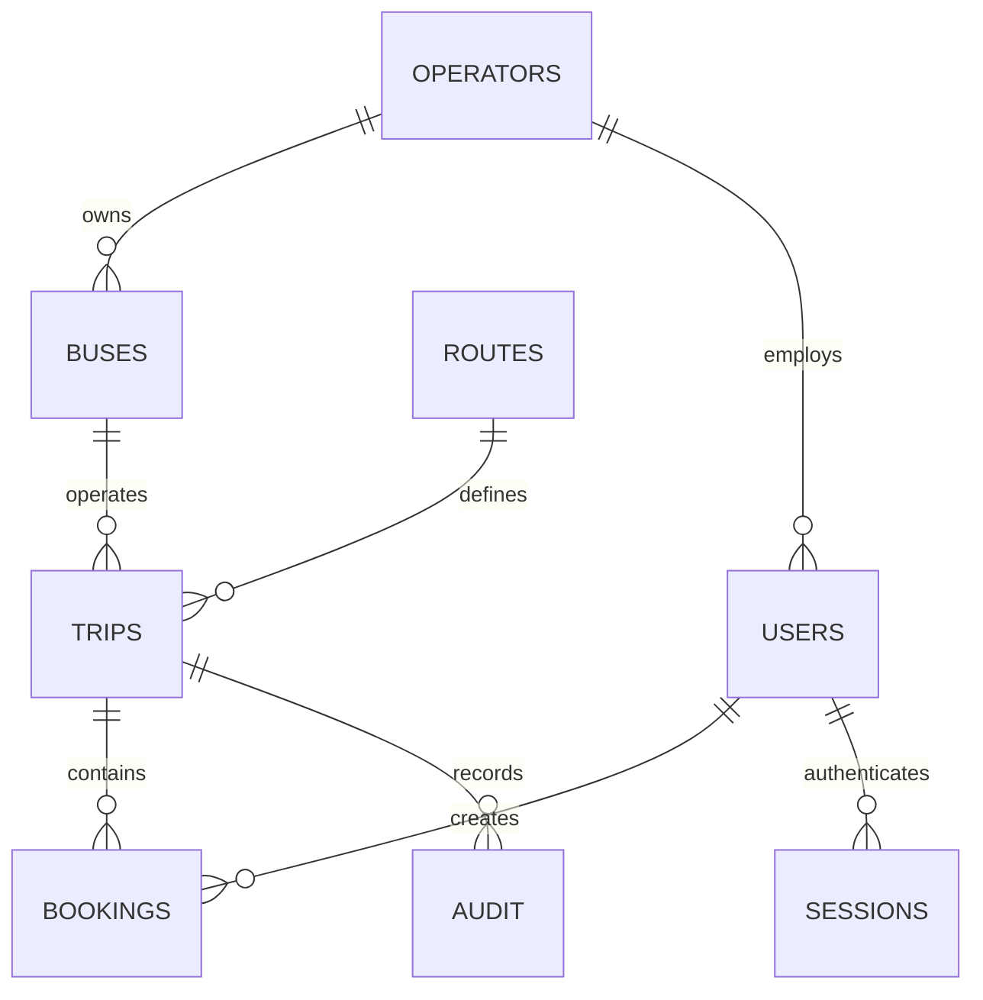

# RouteRelay backend

Node.js, Express and MongoDB backend for a bus booking and disruption recovery assessment. Frontend is the next stage. All money values are integer INR paise; all timestamps are ISO UTC. Search dates use Asia/Kolkata.

## Local setup on Windows

Requires Node.js 22+ and MongoDB Community Server. Run commands from this directory:

```powershell
npm ci
Copy-Item .env.example .env
# Change DEMO_PASSWORD in .env if this will be exposed outside your computer.
powershell -ExecutionPolicy Bypass -File scripts/start-mongo.ps1
npm run seed
npm test
npm start
```

After initial setup, start the database and API together with `powershell -ExecutionPolicy Bypass -File scripts/start-local.ps1`. Keep that terminal open. If running inside an automation environment that terminates child processes when a command exits, run database startup and the desired test/seed command in the same terminal invocation.

The MongoDB helper starts a separate, localhost-only single-node replica set on port 27018. Data and logs are in `.local/mongo`; it does not modify an existing MongoDB service. MongoDB Atlas is also supported: put its URI and a dedicated database name in `.env`. Do not commit credentials. Tests create a random `routerelay_test_*` database, then drop only that test database. Never point tests at an account that lacks permission to create isolated databases.

Frontend: `http://127.0.0.1:4000`. API base: `http://127.0.0.1:4000/api`. Demo accounts: `admin@routerelay.test`, `operator@routerelay.test`, `customer@routerelay.test`. The local demo password is `RouteRelay@2026`. Running `npm run seed` resets only those three demo passwords and adds missing demo records without removing bookings. Change the password before any public deployment. Seven upcoming Delhi–Gurugram–Jaipur trips are provided, plus a replacement bus.

## Frontend

The responsive frontend is served directly by Express from `frontend/`, so there is no separate build or development server. It contains the customer search, seat map, booking, ticket history and cancellation journey; an operator workspace for occupancy, fare/refund summaries, CSV manifests, policy controls, audit history, disruption reporting and safe bus replacement; and an admin workspace for operators, buses/seat layouts, routes/stops, schedules and staff accounts. Authentication is stored in browser session storage and clears when the browser session ends.

Browse the OpenAPI contract at `http://127.0.0.1:4000/docs` or read the raw specification at `/openapi.json`. Supporting submission material is in `docs/`: technical report, demo script, submission checklist, architecture diagram, ER diagram and test evidence.

## Architecture and guarantees

`src/app.js` owns HTTP validation and authorization; `src/bookings.js` owns transactional workflows; `src/domain.js` contains rules; `src/db.js` initializes collections and indexes. Passwords use salted scrypt. Random bearer tokens are stored only as SHA-256 hashes, expire after eight hours and are revoked on logout. Registration always creates a customer. Operator/admin accounts are provisioned by the seed script for this assessment.

Confirmed tickets have a unique `(tripId, seat)` partial index. Booking, cancellation and replacement all write the trip revision inside a MongoDB transaction, so competing mutations retry against current data. A unique `(userId, requestKey)` index protects duplicate confirmation requests. Reusing a key with changed details returns 409. Cancellation preserves the ticket, releases its seat through its status change and records a simulated refund using the policy captured when booked.

Bus replacement requires an operator-owned, unoccupied replacement bus with matching seat labels. Preview returns a revision; confirmation rejects stale revisions. All confirmed tickets retain their PNR and gain a change-history record. Smaller/different layouts require manual attention and are not automatically reassigned. Schedule creation and replacement also write the destination bus document, serializing overlap checks.

## Database diagram



References are string ObjectIds; document primary keys are MongoDB ObjectIds. Buses embed unique seat labels. Routes embed ordered stop names. Trips snapshot seats, stops, route name and cancellation policy. Bookings snapshot passenger, journey, fare and policy, with embedded replacement history. Sessions have a TTL index; expiry is also checked on every request.

## API contract

JSON requests/responses. Protected requests use `Authorization: Bearer <accessToken>`. Lists accept `page` and `limit` (maximum 100). Errors use `{ "error": "message" }`; validation errors also include `details`. Status codes: 400 invalid input, 401 unauthenticated, 403 forbidden, 404 missing, 409 conflict.

| Method and path | Access | Purpose/body |
|---|---|---|
| GET /health, /ready | Public | Process/database readiness |
| POST /api/auth/register | Public | `{name,email,password}`; password 12+ characters |
| POST /api/auth/login | Public | `{email,password}` → accessToken, expiresAt, user |
| GET /api/auth/me | Signed in | Current user |
| POST /api/auth/logout | Signed in | Revoke session |
| GET /api/operators, /api/buses, /api/routes | Staff | Setup lists |
| POST /api/operators | Admin | `{name}` |
| POST /api/buses | Admin | `{operatorId,registration,seats:["1A","1B"]}` |
| POST /api/routes | Admin | `{name,stops:["Delhi","Gurugram","Jaipur"]}` |
| PUT /api/operators/:id, /api/buses/:id, /api/routes/:id | Admin | Same full body as create; existing trip snapshots remain unchanged |
| POST /api/operator-accounts | Admin | `{name,email,password,operatorId}` |
| POST /api/trips | Staff | `{busId,routeId,departure,arrival,fare,cancellationHours:2,refundPercent:90}` |
| PATCH /api/trips/:id/policy | Scoped staff | `{fare,cancellationHours,refundPercent}`; existing booking terms remain unchanged |
| GET /api/trips?origin=Delhi&destination=Jaipur&date=YYYY-MM-DD | Public | Search; returns `{total,items}` |
| GET /api/trips/:id/seats | Public | Trip and seat availability |
| POST /api/bookings | Customer | Body below; required `Idempotency-Key` header, 8–100 characters |
| GET /api/bookings | Signed in | Own booking history |
| GET /api/bookings/:id | Owner/authorized staff | Ticket |
| POST /api/bookings/:id/cancel | Owner/admin | Cancel under stored policy |
| GET /api/operator/trips | Staff | Scoped schedules |
| GET /api/operator/trips/:id/report | Scoped staff | Manifest, occupancy and financial summary |
| POST /api/operator/trips/:id/disrupt | Scoped staff | `{reason}` |
| POST /api/operator/trips/:id/replacement-preview | Scoped staff | `{busId}` → eligibility, affected tickets, revision |
| POST /api/operator/trips/:id/replace-bus | Scoped staff | `{busId,revision}` |
| GET /api/operator/trips/:id/audit | Scoped staff | Business-action history |

Example booking body:

```json
{"tripId":"<trip ObjectId>","seat":"1A","boarding":"Delhi","drop":"Jaipur","passenger":{"name":"Demo Passenger","age":25}}
```

## Current scope and limitations

- One passenger/seat per booking; no temporary seat holds. A successful API response confirms the seat.
- Whole-trip seat reservation and flat trip fare even for intermediate stops. Search shows full-trip departure/arrival; per-stop times are not yet modeled.
- Setup supports create/list/update. No archive or hard deletes of operational history. Existing trip snapshots are preserved when bus/route master records change; scheduled trip times are immutable in this version.
- Simulated refunds only; no payments, messaging or GPS integration.
- Automatic replacement is pre-departure and same-layout only. No recovery after departure or manual remapping yet.
- Service binds localhost for development. Production needs HTTPS, managed secrets, restricted database access, shared rate limiting, backups and deployment configuration.
- Bearer tokens should be kept in memory by the future frontend; do not place them in URLs or logs.

## Verification and demo sequence

`npm test` runs focused unit tests and real HTTP/MongoDB integration tests. Use `npm run test:unit` or `npm run test:integration` separately. Coverage includes stop order, cancellation calculation/cutoff, authorization, duplicate layout validation, registration privilege protection, logout, simultaneous seat contention, idempotency, cancellation and refund, invalid journey/seat, role/ownership checks, replacement rejection/confirmation, stale preview, PNR preservation and report reconciliation.

Demo: login → search tomorrow's trip → book seat → show ticket → mark trip disrupted as operator → preview replacement → confirm → show unchanged PNR and new bus → show manifest → cancel and show released seat.

MongoDB transaction reference: https://www.mongodb.com/docs/drivers/node/current/crud/transactions/
