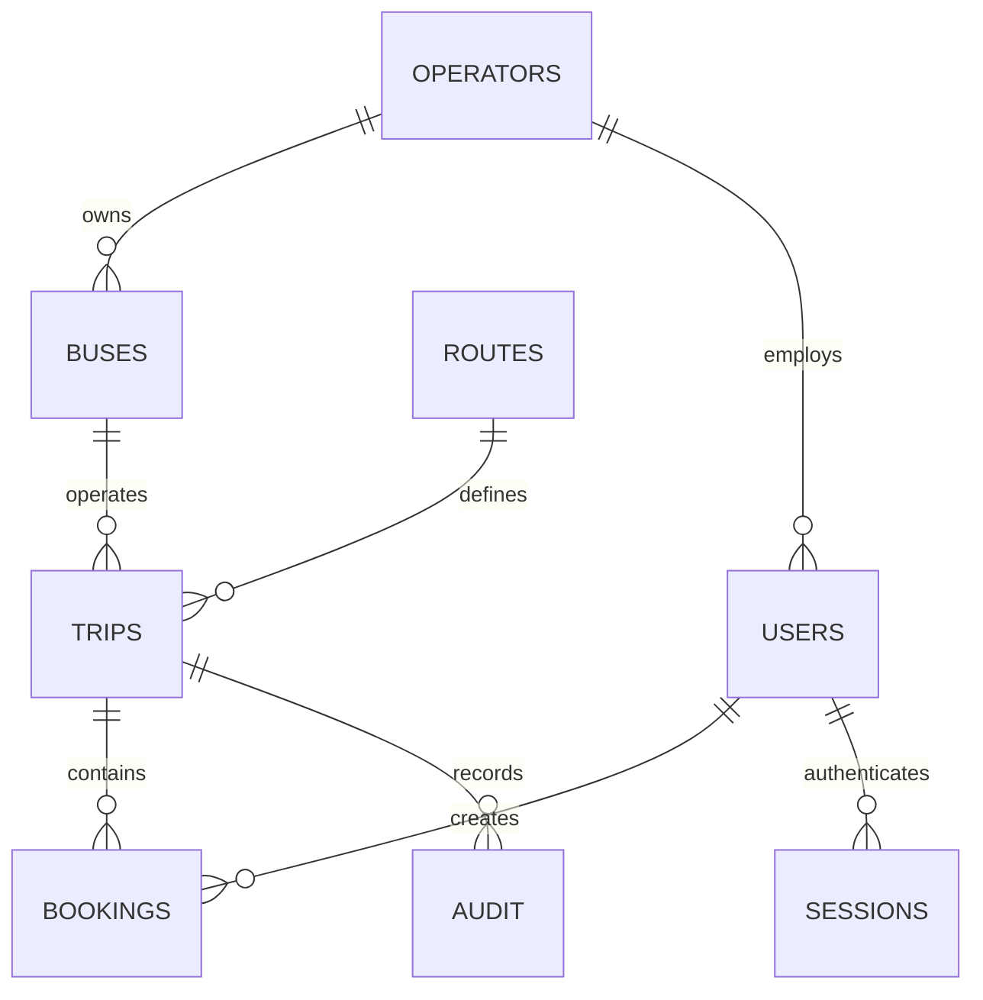

# Algions — Bus Booking Management System

> **Algions AI Labs Private Limited** · Full-Stack Web Development · Advanced Individual Project Assessment

A complete, production-deployed bus booking web application with seat integrity, disruption recovery, operator reporting and role-based access control. Built with Node.js, Express and MongoDB; frontend served by Express with no separate build step.

---

## 🌐 Live Demo

| | |
|---|---|
| **App URL** | **https://algions-tei5.onrender.com** |
| **API Docs / OpenAPI** | https://algions-tei5.onrender.com/docs |
| **Health check** | https://algions-tei5.onrender.com/health |

> [!NOTE]
> Hosted on Render's free tier — the service may take ~50 seconds to wake up after a period of inactivity. Refresh if the first request is slow.

### Demo Accounts

| Role | Email | Password |
|------|-------|----------|
| **Admin** | `admin@routerelay.test` | `RouteRelay@2026` |
| **Operator** | `operator@routerelay.test` | `RouteRelay@2026` |
| **Customer** | `customer@routerelay.test` | `RouteRelay@2026` |

Demo data includes 7 upcoming Delhi–Gurugram–Jaipur trips, 7 upcoming Delhi–Agra–Lucknow trips, 12 sample bookings (including one cancellation with refund), and a replacement bus.

---

## 🏗️ Architecture

A modular monolith: all business logic lives in the server; the frontend is static HTML/JS served by the same Express process.

```
src/
  app.js        — Express routes, HTTP validation, auth middleware, RBAC
  bookings.js   — Transactional booking, cancellation and bus-replacement workflows
  domain.js     — Business rules, Zod schemas, helper validators
  db.js         — MongoDB connection, collection/index setup, transaction helper
  security.js   — scrypt password hashing, bearer token generation and SHA-256 hashing
  server.js     — Process entry point, graceful shutdown
frontend/
  index.html    — Single-page app shell (customer + operator + admin views)
  app.js        — All client-side routing and API calls
  styles.css    — Responsive layout and component styles
  admin.css     — Admin workspace styles
  openapi.json  — OpenAPI 3.1 specification
  docs.html     — Swagger UI
scripts/
  seed.js       — Idempotent demo data seeder
  start-mongo.ps1 / start-local.ps1 — Local MongoDB replica set helpers
docs/           — Technical report, architecture diagram, ER diagram, test evidence
```

**Key design decisions:**
- MongoDB replica set required for multi-document ACID transactions (booking, cancellation, bus replacement all use `withTransaction`)
- Passwords hashed with salted scrypt; bearer tokens stored only as SHA-256 hashes; TTL index expires sessions server-side
- A unique partial index on `(tripId, seat)` where `status = confirmed` enforces seat integrity at the database layer, not just application layer
- Idempotency key (`Idempotency-Key` header) on booking prevents duplicate confirmations from retried requests
- Trip, fare and cancellation policy are snapshotted into each booking at creation time — master record changes do not alter existing bookings

---

## 🗄️ Database Schema



References are string ObjectIds; primary keys are MongoDB ObjectIds. Buses embed unique seat labels. Routes embed ordered stop names. Trips snapshot seats, stops, route name and cancellation policy. Bookings snapshot passenger, journey, fare and policy with embedded replacement history. Sessions have a TTL index; expiry is also checked on every request.

---

## 🔌 API Contract

JSON requests/responses. Protected requests use `Authorization: Bearer <accessToken>`. Lists accept `page` and `limit` (max 100). Errors: `{ "error": "message" }`; validation errors also include `details`.

| Method and path | Access | Purpose / body |
|---|---|---|
| GET /health, /ready | Public | Process / database readiness |
| POST /api/auth/register | Public | `{name,email,password}` — password 12+ chars |
| POST /api/auth/login | Public | `{email,password}` → accessToken, expiresAt, user |
| GET /api/auth/me | Signed in | Current user |
| POST /api/auth/logout | Signed in | Revoke session |
| GET /api/operators, /api/buses, /api/routes | Staff | Setup lists |
| POST /api/operators | Admin | `{name}` |
| POST /api/buses | Admin | `{operatorId,registration,seats:["1A","1B"]}` |
| POST /api/routes | Admin | `{name,stops:["Delhi","Gurugram","Jaipur"]}` |
| PUT /api/operators/:id, /api/buses/:id, /api/routes/:id | Admin | Same full body as create |
| POST /api/operator-accounts | Admin | `{name,email,password,operatorId}` |
| POST /api/trips | Staff | `{busId,routeId,departure,arrival,fare,cancellationHours:2,refundPercent:90}` |
| PATCH /api/trips/:id/policy | Scoped staff | `{fare,cancellationHours,refundPercent}` |
| GET /api/trips?origin=Delhi&destination=Jaipur&date=YYYY-MM-DD | Public | Trip search |
| GET /api/trips/:id/seats | Public | Trip and seat availability |
| POST /api/bookings | Customer | Body below; required `Idempotency-Key` header (8–100 chars) |
| GET /api/bookings | Signed in | Own booking history |
| GET /api/bookings/:id | Owner / staff | Ticket detail |
| POST /api/bookings/:id/cancel | Owner / admin | Cancel under stored policy |
| GET /api/operator/trips | Staff | Scoped schedules |
| GET /api/operator/trips/:id/report | Scoped staff | Manifest, occupancy and financial summary |
| POST /api/operator/trips/:id/disrupt | Scoped staff | `{reason}` |
| POST /api/operator/trips/:id/replacement-preview | Scoped staff | `{busId}` → eligibility and revision |
| POST /api/operator/trips/:id/replace-bus | Scoped staff | `{busId,revision}` |
| GET /api/operator/trips/:id/audit | Scoped staff | Business-action history |

Example booking body:
```json
{"tripId":"<trip ObjectId>","seat":"1A","boarding":"Delhi","drop":"Jaipur","passenger":{"name":"Demo Passenger","age":25}}
```

Full OpenAPI specification: `/openapi.json` · Swagger UI: `/docs`

---

## ✅ Acceptance Tests Covered

| Criterion | How it is met |
|---|---|
| Passenger can search and book a seat | Customer journey: search → seat map → confirm booking → PNR issued |
| Two users cannot confirm the same seat | Unique partial index `(tripId, seat, status=confirmed)` + MongoDB transaction |
| PNR includes correct passenger, route, date and seat | Booking document snapshots all fields at creation |
| Cancellation updates availability and refund status | Status change releases seat; refund amount calculated from stored policy |
| Operator manifest reconciles with confirmed tickets | `/api/operator/trips/:id/report` aggregates confirmed bookings |

---

## 🔒 Security

- **Authentication:** Salted scrypt passwords; random 256-bit bearer tokens stored only as SHA-256 hashes; 8-hour TTL with server-side expiry check on every request
- **Authorization:** Role-based (`admin`, `operator`, `customer`); operator routes additionally scoped to `operatorId`; server never trusts client-claimed identity
- **Rate limiting:** 300 req/min global; 30 req/15 min on auth endpoints; `trust proxy` set for Render's reverse proxy
- **Input validation:** Zod schemas on all endpoints; `helmet` security headers; CORS restricted to `FRONTEND_ORIGIN`
- **Data integrity:** No real credentials committed; `.env.example` placeholder only; demo passwords changeable via `DEMO_PASSWORD` env var

---

## 🧪 Testing

```powershell
npm test                  # all tests (unit + integration)
npm run test:unit         # unit tests only (no DB needed)
npm run test:integration  # real HTTP + MongoDB tests
```

Test coverage includes: stop order validation, cancellation calculation and cutoff, authorization checks, duplicate seat layout rejection, registration privilege protection, logout and session revocation, simultaneous seat contention (race condition), idempotency key enforcement, cancellation refund calculation, invalid journey/seat detection, role and ownership enforcement, bus replacement rejection and confirmation, stale preview detection, PNR preservation through replacement, and report reconciliation.

---

## 🖥️ Local Setup (Windows)

**Requirements:** Node.js 22+, MongoDB Community Server

```powershell
# 1. Install dependencies
npm ci

# 2. Create environment file
Copy-Item .env.example .env
# Edit DEMO_PASSWORD in .env if exposing outside localhost

# 3. Start local MongoDB replica set (port 27018, localhost-only)
powershell -ExecutionPolicy Bypass -File scripts/start-mongo.ps1

# 4. Seed demo data
npm run seed

# 5. Run tests
npm test

# 6. Start server
npm start
```

After initial setup, use `powershell -ExecutionPolicy Bypass -File scripts/start-local.ps1` to start the database and API together.

- **Frontend:** http://127.0.0.1:4000
- **API base:** http://127.0.0.1:4000/api
- **API docs:** http://127.0.0.1:4000/docs

---

## ☁️ Production Deployment (Render)

The repo includes a `render.yaml` for one-click deployment.

**Required environment variables on Render:**

| Variable | Value |
|---|---|
| `MONGODB_URI` | MongoDB Atlas connection string (replica set required) |
| `MONGODB_DB` | `routerelay` |
| `FRONTEND_ORIGIN` | Your Render service URL (e.g. `https://algions-tei5.onrender.com`) |
| `DEMO_PASSWORD` | Strong password (12+ chars) for demo accounts |
| `NODE_VERSION` | `22` |

After deploying, seed the database by running `node scripts/seed.js` with the Atlas URI set locally:

```powershell
$env:MONGODB_URI="<your Atlas URI>"; $env:MONGODB_DB="routerelay"; $env:DEMO_PASSWORD="<password>"; node scripts/seed.js
```

> MongoDB Atlas free M0 cluster works. Add `0.0.0.0/0` to Network Access since Render IPs are dynamic.

---

## ⚠️ Known Limitations

- One passenger/seat per booking; no temporary seat holds — a successful API response confirms the seat atomically
- Flat trip fare regardless of boarding/drop points; per-stop times not modeled
- Create/list/update supported for setup resources; no archive or hard delete of operational history
- Simulated refunds only — no payment gateway, SMS/email notifications or GPS integration
- Bus replacement is pre-departure and same seat-layout only; no post-departure recovery or manual seat remapping
- Free Render plan spins down after inactivity (~50 s cold start); upgrade to Starter for always-on hosting
- Bearer tokens stored in browser `sessionStorage` — cleared when browser session ends (intentional for demo security)

---

## 📁 Supporting Documentation

All submission material is in `docs/`:
- Technical report (PDF/Markdown)
- Architecture diagram
- ER diagram
- Test evidence screenshots
- Demo script

OpenAPI specification: [`frontend/openapi.json`](frontend/openapi.json) · Swagger UI: [`/docs`](https://algions-tei5.onrender.com/docs)

---

## 🛠️ Technology Stack

| Layer | Technology |
|---|---|
| Runtime | Node.js 22 (ESM) |
| Framework | Express 5 |
| Database | MongoDB 6 (replica set, transactions) |
| Validation | Zod 4 |
| Security | helmet, express-rate-limit, scrypt, SHA-256 |
| Frontend | Vanilla HTML/CSS/JS (no framework, no build step) |
| Hosting | Render (free web service) + MongoDB Atlas (free M0) |
| Testing | Node.js built-in test runner |

---

*All money values are integer INR paise. All timestamps are ISO 8601 UTC. Search dates use Asia/Kolkata (IST).*

*MongoDB transaction reference: https://www.mongodb.com/docs/drivers/node/current/crud/transactions/*
